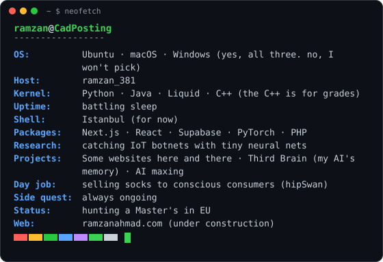

<!-- SVGs are generated by scripts/ and refreshed daily by .github/workflows/update-profile-art.yml -->

<table>
<tr>
<td valign="top"></td>
<td valign="top"></td>
</tr>
</table>

<a href="https://www.linkedin.com/in/ramzan381/">linkedin</a>

<a href="https://ramzanahmad.com">ramzanahmad.com</a>

